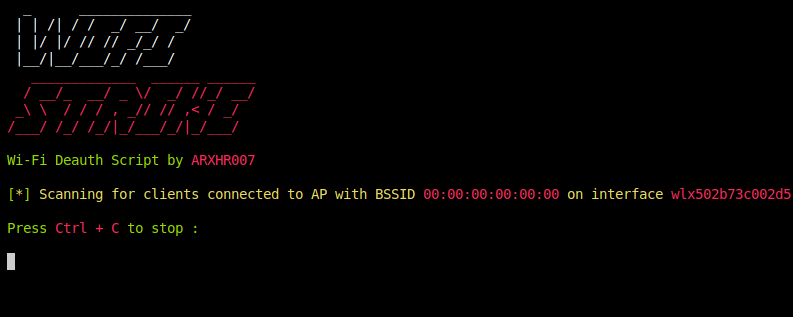

<p align="center">
  
</p>

# WiFiStrike

<p align="center">
  <a href="#"></a>
  <a href="#"></a>
  <a href="#"></a>
  <a href="#"></a>
  <a href="https://github.com/arxhr007/wifistrike/issues"></a>
</p>

<h3 align="center">A Pure Python WiFi Deauthentication Tool</h3>

---

## 🔍 Overview

WiFiStrike is a powerful, pure Python implementation of a WiFi deauthentication tool that doesn't rely on the Aircrack-ng suite. It provides an automated, user-friendly approach to WiFi analysis and deauthentication testing.

**Key Features:**
- 🔍 Automatic network interface detection
- 📡 Access point scanning with detailed information
- 👥 Client device discovery
- 🛑 Targeted and broadcast deauthentication
- 📊 Signal strength monitoring
- 🚀 Clean, colorful command-line interface

## ⚡ Advantages Over Aircrack-ng

WiFiStrike offers several benefits compared to traditional Aircrack-ng based tools:

- **Pure Python Implementation**: No dependency on external C-based tools or libraries
- **Simplified Workflow**: Single command operation vs multi-step process in Aircrack-ng
- **Automatic Interface Management**: Auto-detection and mode switching without manual steps
- **Lower Footprint**: Lighter resource usage compared to full Aircrack-ng suite
- **Modern Codebase**: Python-based for easier customization and extension
- **Single Tool**: All functionality in one command vs multiple tools (airmon-ng, airodump-ng, aireplay-ng)
- **Cleaner Output**: Colored, structured terminal output for better readability
- **Less Dependencies**: Minimal external dependencies to install
- **User-Friendly**: Guided operation with clear prompts and options
- **Portability**: Easier to deploy across different Linux distributions

## ⚠️ Disclaimer

**This tool is provided for EDUCATIONAL PURPOSES ONLY.**

WiFiStrike is designed for network administrators and security professionals to test their own networks. Using this tool on networks without explicit permission is illegal in most jurisdictions and unethical. The author accepts NO responsibility for misuse of this tool.

See [SECURITY.md](SECURITY.md) for authorized testing scenarios, the
real-world impact of deauthentication attacks, a controlled lab-testing
procedure, and how to report vulnerabilities in the tool itself.

## 🔧 Requirements

- Linux-based operating system
- Python 3.x
- WiFi adapter supporting monitor mode and packet injection
- Root privileges

## 🔌 Supported Network Adapters

WiFiStrike works with most WiFi adapters that support monitor mode ( Most modern laptops has inbuild monitor mode supporting wifi adapters ), including:
- Alfa AWUS036ACH
- TP-Link TL-WN722N (v1)
- Panda PAU09
- Many other Atheros, Ralink, and Realtek chipset-based adapters

## 📦 Installation

Installation requires root (it copies a script into `/usr/bin` and installs
packages), so **do not pipe a downloaded script straight into `bash`** —
always fetch the source, review it, and verify it's what you expect before
running anything as root.

### Verifiable Installation

```bash
# 1. Clone the repository (or download+extract a tagged release instead)
git clone https://github.com/arxhr007/wifistrike
cd wifistrike

# 2. Verify you're on a commit/tag you trust, e.g. check the commit hash
#    matches what's shown on GitHub for this repo/tag:
git log -1 --format="%H %ci"

# 3. Read install.sh before running it — it will run as root
cat install.sh

# 4. Install required Python packages
sudo pip install -r requirements.txt

# 5. Run the installation script
sudo bash install.sh
```

If you prefer not to clone with `git`, download a specific release
archive from the [Releases page](https://github.com/arxhr007/wifistrike/releases)
or the [repository's commit history](https://github.com/arxhr007/wifistrike/commits/main)
over HTTPS from `github.com` directly (not a third-party paste site), so the
content you're running is attributable to a specific, auditable commit
rather than an unversioned, unreviewable paste.

### Uninstall is Reversible

See [Uninstallation](#%EF%B8%8F-uninstallation) below — `uninstall.sh` removes
`/usr/bin/wifistrike` if you want to remove the tool.

## 🚀 Usage

### Basic Usage
```bash
sudo wifistrike
```
This will auto-detect your network interfaces and guide you through the attack options.

### Specifying Network Interface
```bash
sudo wifistrike -i [interface_name]
# Example:
sudo wifistrike -i wlan0
```

### Advanced Options

#### Target Specific Devices
```bash
# Set gateway (access point) MAC address manually
sudo wifistrike -g [gateway_mac]

# Set target client MAC address manually
sudo wifistrike -t [target_mac]

# Deauthenticate all clients
sudo wifistrike -t 0
```

#### Combined Parameters
```bash
sudo wifistrike -i [interface] -g [gateway_mac] -t [target_mac]
# Example:
sudo wifistrike -i wlan0 -g 11:22:33:44:55:66 -t aa:bb:cc:dd:ee:ff
```

#### Interface Management
```bash
# Set interface to managed mode
sudo wifistrike --man [interface]

# Set interface to monitor mode
sudo wifistrike --mon [interface]
```

#### Reconnaissance
```bash
# List all network interfaces
sudo wifistrike -l

# Scan for available WiFi networks
sudo wifistrike -sw

# Scan for client devices connected to an access point
sudo wifistrike -st

# Scan for clients on a specific access point
sudo wifistrike -st -g [gateway_mac]
```

#### Silent Mode
```bash
sudo wifistrike -i [interface] -g [gateway_mac] -t [target_mac] > /dev/null 2>&1
```

## 📝 Command Reference

| Command | Description |
|---------|-------------|
| `-i`, `--interface` | Specify network interface |
| `-g`, `--gateway_mac` | Set access point MAC address |
| `-t`, `--target_mac` | Set target client MAC address |
| `-l`, `--list_interface` | List available network interfaces |
| `-sw`, `--scan_wifi` | Scan for WiFi networks |
| `-st`, `--scan_target` | Scan for connected clients |
| `--man` | Set interface to managed mode |
| `--mon` | Set interface to monitor mode |

## 🧪 Tests

Unit tests build and parse synthetic Scapy packets in-process (no interface,
root, or radio required) to validate frame construction and parsing logic.

```bash
pip install -r requirements.txt -r requirements-dev.txt
pytest
```

See [`tests/README.md`](tests/README.md) and
[SECURITY.md's lab-testing section](SECURITY.md#controlled-lab-testing) for
details, including how to move from these offline tests to controlled,
RF-isolated lab testing.

## 🗑️ Uninstallation

```bash
sudo bash uninstall.sh
```

## 📸 Screenshots



## 👨‍💻 Author

- **Aaron** ([@arxhr007](https://github.com/arxhr007))

## 🔗 Check Out My Other Projects

<a href="https://github.com/arxhr007/Aliens_eye" target="_blank">
  
</a>
<a href="https://github.com/arxhr007/Malware-Sandbox-Evasion" target="_blank">
  
</a>

## 📄 License

This project is licensed under the MIT License - see the LICENSE file for details.
